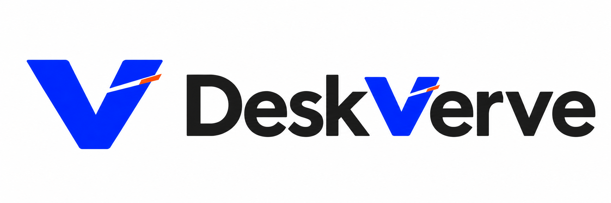

# DeskVerve



DeskVerve for Windows is a C# WinUI 3 app by [Quantum Step](https://quantumstep.in) for updating and installing software with winget. The current app requires administrator approval at every launch and opens at **Sign in**. Accounts and the account service are local to this PC.

## Source and local programs

- Windows app source: `src/QuantumUpdater` (`src/QuantumUpdater/QuantumUpdater.csproj`).
- Local account service source: `src/QuantumUpdater.Portal` (`src/QuantumUpdater.Portal/QuantumUpdater.Portal.csproj`).
- Release app: `src/QuantumUpdater/bin/Release/net8.0-windows10.0.19041.0/win-x64/QuantumUpdater.exe`
- Release portal: `src/QuantumUpdater.Portal/bin/Release/net8.0/QuantumUpdater.Portal.exe`

The local admin address is `http://127.0.0.1:8787/quantumupdater/admin`. The desktop app does not open admin routes.

Build either project with the standard .NET command:

```powershell
dotnet build src/QuantumUpdater/QuantumUpdater.csproj
dotnet build src/QuantumUpdater.Portal/QuantumUpdater.Portal.csproj
```

## Current status

The Release build includes Sign in, Getting ready, Updates & Health, App Marketplace, Installed, and About This PC. Phase 46 (Disk & Storage, Cleanup, Settings waves, and Chocolatey scope) is not built.

An existing self-contained portable package is at `dist/QuantumUpdater-Windows-3.0.0.zip`; it has not been uploaded. There is no public 3.0.0 release or MSIX installer yet.

Legacy technical names—including `QuantumUpdater.exe`, project paths, package names, `%LOCALAPPDATA%\QuantumUpdater`, `/quantumupdater/admin`, and `QuantumStep.QuantumUpdater`—remain unchanged for compatibility until the packaging migration.

Mac work is a later, separate branch and product: **DeskVerve for Mac** on `channel/macos`. It is not part of this Windows build.
