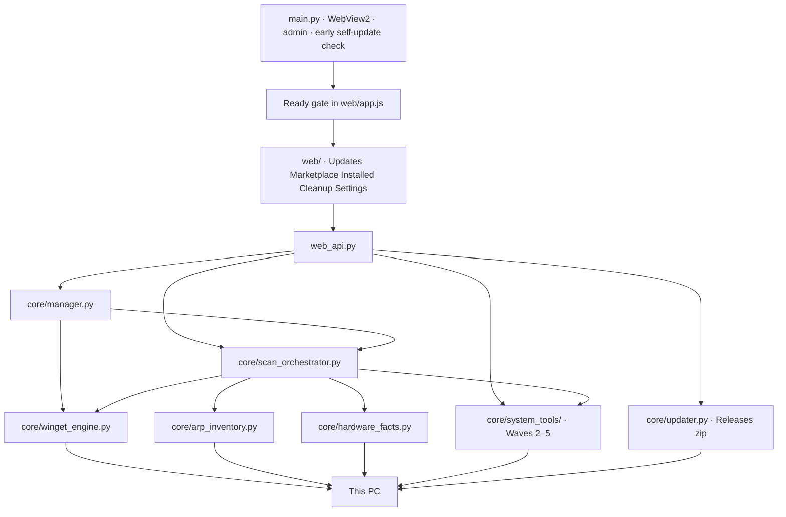
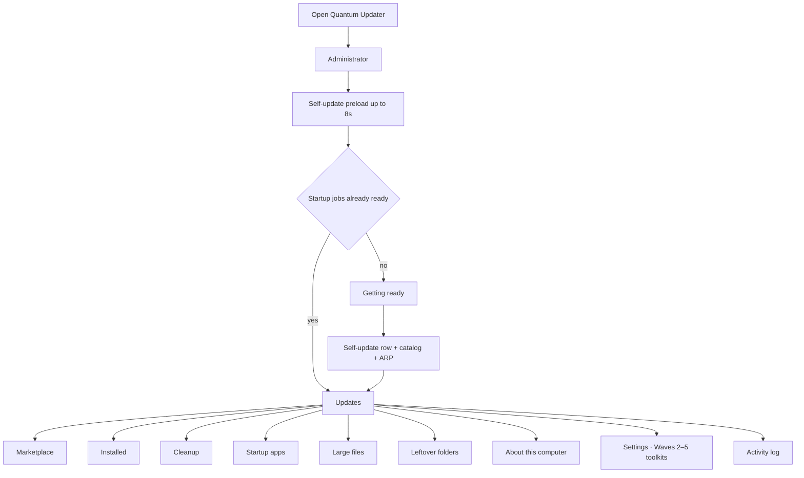

# Quantum Updater — system picture

**Product:** Quantum Updater for Windows  
**Publisher:** Quantum Step (quantumstep.in)  
**Version:** 2.0.0 · Build 8+  
**This picture:** the Windows app on this PC. Refreshed 2026-11-15 (Manager provisional; Design Architect seat at model limit).

The window is `main.py`. It asks for administrator once at start, then opens the screens in WebView2. The screens live in `web/`. The bridge is `web_api.py`. The work runs in `core/`. A test is a new `QuantumUpdater.exe` (full onedir folder) opened on this PC.

## Protective middle layer

No new protective middle layer is needed.

`web_api.py` is the middle. The screens call that bridge. The bridge is the only path that starts a program, a scan, or a delete. Checks already on that path include package-id allow-lists, confirm gates on destructive Settings tools, uninstall plan refusal of a shell, and official-only self-update downloads.

## Live colours

Cream / orange / black remain the live CSS until the owner locks Park D (`41.1`). Park mockups under `design/mockups/directions/park/` are provisional — do not change live theme colours without that lock.

## Releases and self-update

Official channel: `merchanthasan2/AudoChocolatey` GitHub Releases (tag `v*`).

- CI builds an **onedir** package and publishes **`QuantumUpdater-Windows.zip`** (exe + `_internal`).
- A lone bootloader `.exe` without `_internal` will not start (Python errors). Do not publish that as the install asset.
- In-app self-update (`core/updater.py`) prefers setup exe, then the Windows zip, then any zip, then a bare exe last. Zip apply unpacks and `robocopy`s over the installed folder after exit.
- `main.py` preloads a self-update check (42.5) before the window works; offline does not block.

## System picture

Scan lanes:

| Lane | Jobs | When they start | Ready gate |
|---|---|---|---|
| Catalog | `catalog-updates`, then `catalog-installed` | After self-update preload settles | Yes |
| Local | `local-arp`, `local-hardware` | ARP on bootstrap; hardware when About opens | ARP yes |
| Disk | `cleanup_scan`, large files | When Cleanup / Large files open | No |
| Polish | `startup`, `leftovers` | When that screen opens | No |

Winget install/upgrade streaming times out after 600s and kills the process tree so a stuck package does not freeze the batch (ADR 037).

## Screen flow

Settings holds repair and toolkit cards (no new sidebar tab): catalog sources, Store repair, print queue, catalog export/import, app repair, duplicates, orphan uninstall, scheduled cleanup, Windows health, network/power, files, advanced tools. Destructive actions require UI confirm plus `confirmed=true` on the bridge.

Sidebar order after unlock: Updates, Marketplace, Installed, Cleanup, Startup apps, Large files, Leftover folders, Activity log, About this computer, Settings.

## Parts

| Part | Role |
|---|---|
| `main.py` | Window, WebView2, elevation, early self-update preload, startup crash log. |
| `web/` | Screens, ready gate, Settings cards. |
| `web_api.py` | Bridge. |
| `core/winget_engine.py` | Catalog + streaming install/upgrade with timeout. |
| `core/updater.py` | GitHub Releases; Windows zip preferred. |
| `core/system_tools/` | Cleanup, startup, leftovers, Waves 2–5 toolkits. |
| `build_exe.py` | PyInstaller onedir → `dist/QuantumUpdater/`. |
| `.github/workflows/release.yml` | Tag `v*` → zip + winget YAML assets. |

## What this refresh changed

- Build stamp and release asset are the full Windows zip, not a bare onedir bootloader.
- Waves 2–5 Settings tools sit behind `web_api.py`.
- Self-update preload is on the ready-gate path.
- Park D stays owner-later for live CSS; cream remains live until lock.
- No new protective middle layer.
