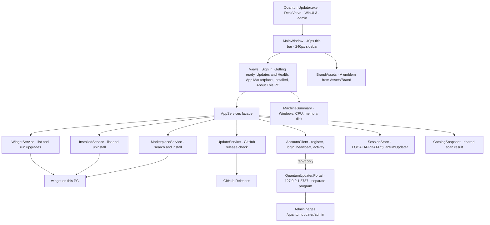
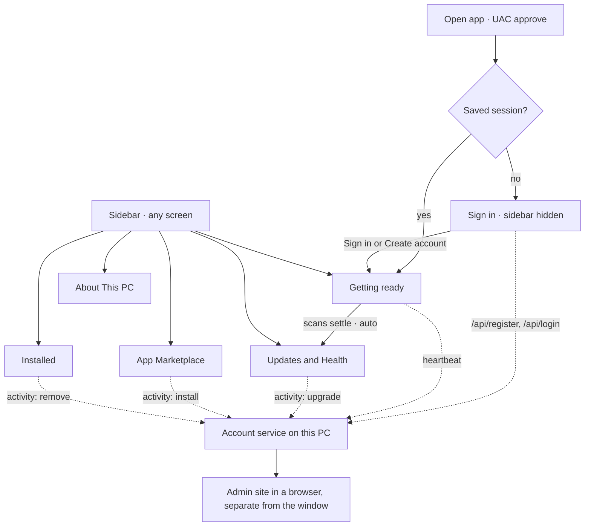
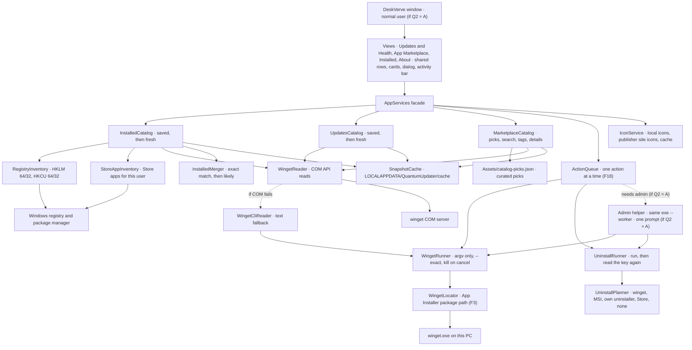
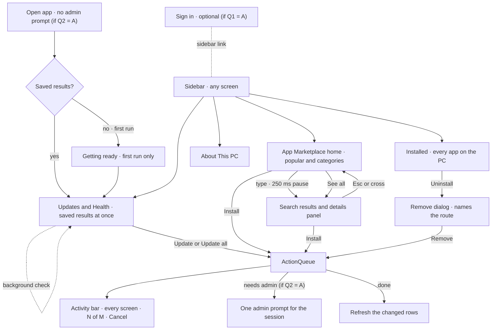
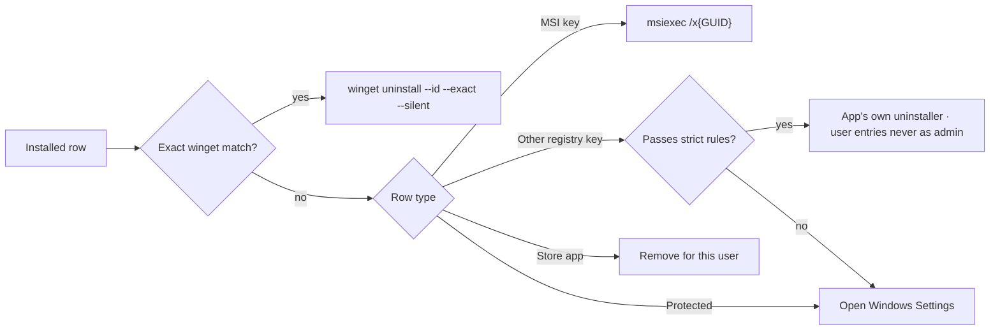

# DeskVerve — system picture

**Product:** DeskVerve for Windows

**Publisher:** Quantum Step (quantumstep.in)

**Stack:** C# + WinUI 3 (ADR 043)

**Reference:** Python app in `archive/python-app`. Phase 1 WinUI seed in `archive/winui-phase1`.

**This picture:** refreshed 2026-11-16 after the DeskVerve rename and logo (ADR 046, ADR 047). It shows the Phase A app as built. The section "Planned: Phase 46 priority" shows proposed changes only. Those parts are not built.

## Protective middle layer

**Required:** one C# service layer under `src/QuantumUpdater/Services/`.

- UI (`Views/`) calls services only. `AppServices` is the facade.
- Services own winget, the GitHub release check, and the account client. Allow-lists and confirm gates stay in the services.
- No second bridge. Page code does not start processes.
- The account service is a separate program, `src/QuantumUpdater.Portal`. The desktop app never requests admin routes.

## Live colours

**Current rule:** ADR 043 Q4 (2026-11-15). The Stitch dark shell is live. It replaces the Cream, Orange, and Black theme of 12 Nov and the Park direction.

WinUI uses the Stitch dark shell (`Theme.cs`): canvas `#131313`, sidebar `#272727`, cards `#2C2C2C`, stroke `#383838`, accent `#0078D4`. Status colours: healthy `#27AC62`, warning `#D8A000`, critical `#E81123`.

The cobalt and orange in the DeskVerve V are artwork colours only. They are not UI tokens.

## Brand assets

- Transparent V-only master: `brand/desk-verve-emblem.png` (449 x 301). Sized square PNGs: `brand/png/desk-verve-emblem-{32,64,128,256,512}.png`. Windows icon: `brand/desk-verve-icon.ico`.
- The build copies the master and the icon to `Assets/Brand/` next to the executable. `BrandAssets.Emblem(size)` loads the master from that file path, not from `ms-appx:///`.
- The csproj sets `ApplicationIcon` to `brand/desk-verve-icon.ico`.
- Full lockups: `brand/desk-verve-lockup-transparent.png` and `brand/desk-verve-lockup-white.png`. Owner originals: `brand/source/`.
- Old file names `brand/quantum-updater*.{svg,ico,png}` stay for compatibility. They now contain the DeskVerve V.
- Use the transparent V-only emblem on dark surfaces and the full lockup on light surfaces. Never place the full black wordmark directly on dark surfaces.

| Surface | Emblem box | Where |
|---|---|---|
| Title bar | 24 x 24 | `MainWindow.xaml.cs` |
| Sign in | 64 x 64 | `Views/SignInPage.cs` |
| About This PC | 40 x 40 | `Views/AboutPage.cs` |
| Tracker header | 52 x 52, 4px padding | `tracker.html` |
| README | White lockup, 320px wide | `README.md` |

## Releases

- Asset name stays `QuantumUpdater-Windows.zip` (self-contained win-x64 folder) until phase 47 (ADR 046).
- `.github/workflows/release.yml` still builds the Python zip. Phase 47 changes it to WinUI.
- `dist\QuantumUpdater\` holds the old Python build. The current WinUI build is `src/QuantumUpdater/bin/Release/net8.0-windows10.0.19041.0/win-x64/QuantumUpdater.exe`.
- Winget portable zip continues to point at that asset name.
- Self-update: About checks the GitHub latest release. "Install update" stays off until the installer exists.

## System picture (WinUI — Phase A built)

`DiskService` and `StartupService` exist in `Services/` but no screen uses them yet. Tracker phase 46 decides their use.

## Screen flow (Phase A — built)

Design source: Stitch project Modern Windows System Toolkit (`11437327097635848724`).

Getting ready runs three checks at the same time: winget upgrades, installed packages, and the DeskVerve release check. It then sends a heartbeat and opens Updates and Health one time.

Disk & Storage, Cleanup, Settings waves, and Chocolatey are discussed in tracker phase 46 before they are built.

## Planned: Phase 46 priority (NOT BUILT)

> **PLANNED.** This section is a proposal from 16 Nov 2026. Plan: `docs/plans/2026-11-16-phase46-apps-first.md`. Mockups: `design/mockups/phase46/`. Nothing here is built. Parts marked "if Q2 = A" depend on an owner answer. Move this section into the built picture only after the Design Architect gives PASS.

### Planned system picture

Planned changes to the built picture:

- `WingetService`, `InstalledService` and `MarketplaceService` share one `WingetRunner` and one `WingetLocator` (tracker 45.17: F3, F4, F16, F18, F24).
- `CatalogSnapshot` is retired. `InstalledCatalog` and `UpdatesCatalog` replace it.
- Reads use the winget COM API. Changes (install, upgrade, uninstall) use the hardened winget command.
- The Installed list comes from Windows first (registry and Store apps). winget adds the catalog id and the update state.
- Protective middle layer: still one C# service layer. If Q2 = A, the admin helper is part of that layer. It checks every request again and never runs a command line from the window.

### Planned screen flow

### Planned uninstall routes

## Phase map

| Phase | Screens / work | When |
|---|---|---|
| 44 | Packaging tools, archive Python, empty greenfield project | Done |
| 45 | Sign-in, Getting ready, Updates & Health, Marketplace, Installed, About, self-update check, DeskVerve rename and logo | Built. Owner on-PC check and validation open |
| 46 | ADR 048 order: first Installed, Marketplace and Updates (46.5 to 46.7, planned in `docs/plans/2026-11-16-phase46-apps-first.md`); then Disk (46.1); then Cleanup (46.2); then old tool groups. Chocolatey later | Planned — not built |
| 47 | Installer, portable zip, then Store, Chocolatey, winget, GitHub, download libraries. DeskVerve exe and zip names | Zip can be built here. Installer and submissions are owner later |
| 48 | Admin portal | Local service built. Domain deploy is owner later |

## Parts

| Part | Role |
|---|---|
| `src/QuantumUpdater/` | Windows app (DeskVerve) |
| `src/QuantumUpdater/Services/` | Protective middle layer |
| `src/QuantumUpdater/Views/` | Screens |
| `src/QuantumUpdater/Theme.cs`, `Chrome.cs`, `BrandAssets.cs` | Colours, shared controls, emblem loader |
| `src/QuantumUpdater.Portal/` | Account service and admin pages |
| `brand/` | DeskVerve artwork and compatibility copies |
| `archive/python-app/` | Old Python app, reference only |
| `.github/workflows/release.yml` | Still the Python zip until phase 47 |
