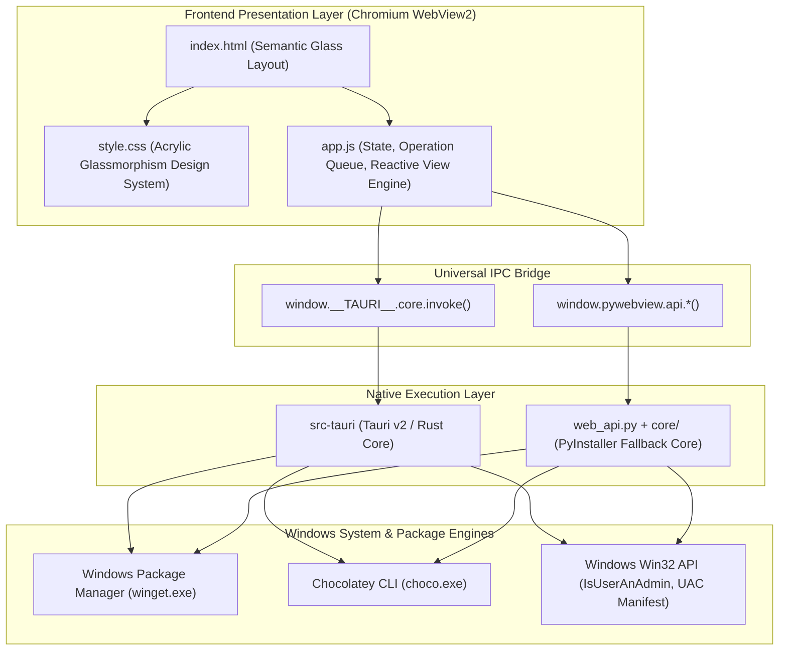

# Architecture Documentation: Quantum Updater
**Publisher:** Quantum Step ([quantumstep.in](https://quantumstep.in))  
**Version:** 2.0.0  
**Stack:** Tauri v2 (Rust) / Python pywebview Fallback + HTML5/CSS3/Vanilla JS (Chromium WebView2)

---

## 1. High-Level Architectural Overview

Quantum Updater employs a **Decoupled Dual-Engine Architecture** pairing native system-level backend orchestration with a high-performance, hardware-accelerated Microsoft Edge WebView2 rendering shell.



---

## 2. Component Breakdown

### 2.1 Frontend Presentation Layer (`web/`)
- **`index.html`**: Semantic document structure hosting the Top Glass Navigation Bar, Bento Grid, Floating Progress Island, Tab Panels (Updates, Explore, Installed, Console, Settings), the Cross-Tab Global Operation Dock, the Expandable Queue Drawer, and the Package Security Inspector Modal.
- **`style.css`**: Complete Acrylic Frosted Glass design system. Employs hardware-accelerated backdrop filters (`backdrop-filter: blur(28px)`), specular 1px border lighting (`inset 0 1px 0 rgba(255, 255, 255, 0.12)`), radial mesh atmospheric orbs, and CSS custom properties for instant dark/light theme switching.
- **`app.js`**: Universal application controller containing:
  - **Universal Bridge Initializer**: Autodetects whether running inside native Tauri v2 (`window.__TAURI__`) or PyWebView (`window.pywebview`).
  - **Sequential Operation Queue Manager**: Thread-safe client queue preventing concurrent installer invocations.
  - **Curated Software Catalog**: Over 70 curated applications across 9 categories with direct CDN logos.
  - **Live State Caches**: `installedSet`, `updates`, `selectedIds`, and `diagnostics`.

### 2.2 Native Rust Backend (`src-tauri/`)
- **`main.rs`**: Clean Windows executable entry point invoking `lib.rs::run()`.
- **`lib.rs`**: Core Tauri commands:
  - `get_diagnostics`: Gathers Windows version, architecture, engine availability, and elevation status via `windows_sys::Win32::UI::Shell::IsUserAnAdmin()`.
  - `scan_updates`: Executes silent winget/choco upgrade scans using `parse_winget_tabular_output()`.
  - `upgrade_packages`: Iterates through queued package IDs, streams progress events (`progress-update`, `log-line`), and handles Authenticode / SHA-256 verification output.
  - `search_catalog`: Queries remote repositories with positional tabular parsing.
  - `install_package`: Performs single-package verified installation.
  - `get_installed`: Audits all installed programs from the system registry and package manager cache.
  - `uninstall_package`: Triggers silent removal routines.
- **`windows/manifest.xml`**: Embedded application manifest containing `<requestedExecutionLevel level="requireAdministrator" uiAccess="false"/>` ensuring single-prompt launch elevation.

### 2.3 Python Engine (`core/` & `web_api.py`)
- **`core/winget_engine.py`**: Robust Python implementation of the Windows Package Manager engine with asynchronous streaming subprocess wrappers, ANSI code stripping, carriage-return (`\r`) progress decoding, and column-position table parsing.
- **`core/choco_engine.py`**: Chocolatey engine interface.
- **`core/manager.py`**: Central coordinator managing worker threads, engine switching, and process cancellation.
- **`web_api.py`**: Thread-safe RPC bridge exposed to JavaScript through `pywebview`.

---

## 3. Critical Technical Design Patterns

### 3.1 Silent Process Execution (`CREATE_NO_WINDOW`)
To prevent disruptive black command-line window flashing when executing background tasks, all process spawning routines explicitly configure Windows creation flags:
```rust
const CREATE_NO_WINDOW: u32 = 0x08000000;

Command::new("winget")
    .args(&[...])
    .creation_flags(CREATE_NO_WINDOW)
    ...
```
In Python:
```python
flags = 0x08000000 if os.name == 'nt' else 0
startupinfo = subprocess.STARTUPINFO()
startupinfo.dwFlags |= subprocess.STARTF_USESHOWWINDOW
startupinfo.wShowWindow = 0
```

### 3.2 Multi-Table Fixed-Column Positional Parser
Winget outputs formatted tables where columns align under header tokens (`Name`, `Id`, `Version`, `Available`, `Source`). Traditional whitespace splitting fails when:
1. Application names contain spaces (e.g. `Windows Subsystem for Linux`).
2. Packages belong to the "Explicit targeting required" secondary table (e.g. `Discord`).
3. The `Source` column is blank for non-store packages.

The parser scans for table header rows, records character index positions (`id_pos`, `ver_pos`, `avail_pos`, `src_pos`), and extracts slices safely using column boundaries across all output tables.

### 3.3 Asynchronous Sequential Operation Queue
Because the Microsoft Windows Installer (MSI) service enforces an exclusive installation mutex (`_MSIExecute`), initiating concurrent installations results in immediate failure with Error 1618. Quantum Updater routes all install, update, and uninstall requests through an asynchronous sequential FIFO queue. The queue executes one job at a time, tracks progress reactively, and updates the cross-tab Global Operation Dock and Queue Drawer.
