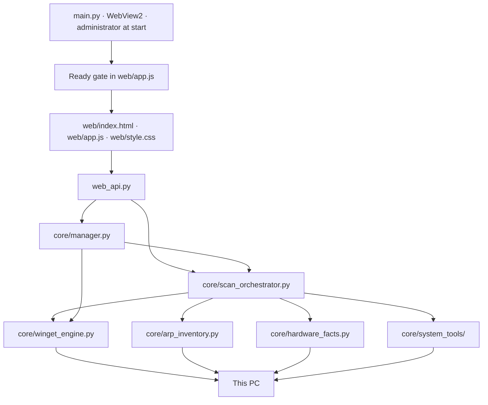
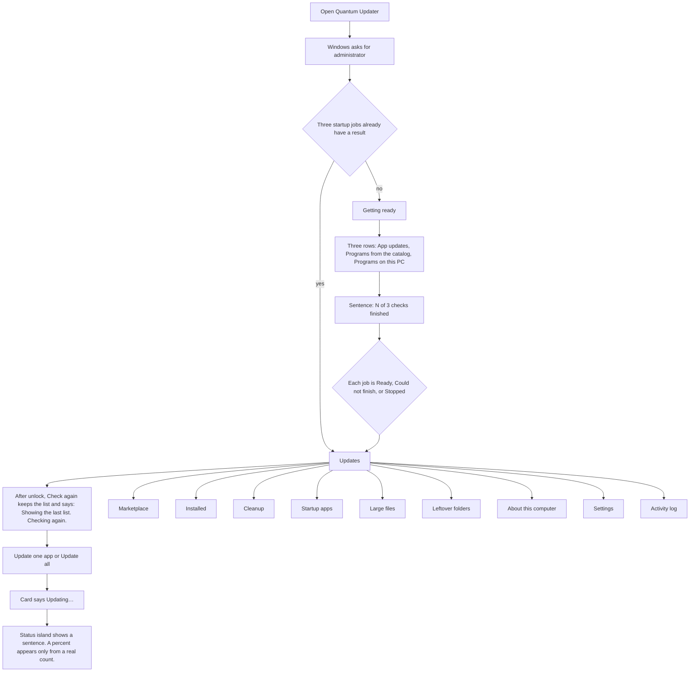

# Quantum Updater — system picture

**Product:** Quantum Updater for Windows  
**Publisher:** Quantum Step (quantumstep.in)  
**Version:** 2.0.0 · Build 5  
**This picture:** the Windows app on this PC. Refreshed 2026-11-12 for the cream theme, the ready gate, and the speed slices.

The window is `main.py`. It asks for administrator once at start, then opens the screens in WebView2. The screens live in `web/`. The bridge is `web_api.py`. The work runs in `core/`. A test is a new `QuantumUpdater.exe` opened on this PC.

## Protective middle layer

No new protective middle layer is needed.

`web_api.py` is the middle. The screens call that bridge. The bridge is the only path that starts a program, a scan, or a delete. These checks already sit on that path:

- An uninstall plan allows the app's own uninstaller and refuses a shell.
- A download accepts only a normal package id.
- Cleanup and leftover removal ask for consent before a delete.
- Run installer starts only when that app's installer is already in its download folder.

The cream theme is colour in `web/style.css`. It starts no program.

The ready gate reads `scans_state` on the same bridge. It hides navigation until the startup jobs settle. It adds no new service and no new program start.

The speed slices change when existing jobs start, and how a catalog call reports its lines. They stay on `web_api.py`.

## Live colours

Cream, orange, and black are the live theme. Gray shades are allowed. Teal, mint, and ocean are retired as brand colours.

The cream files in `design/mockups/cream/` are the live direction. Direction A and Direction B in `design/mockups/index.html` are older studies.

Light is the default window. Dark is the existing `html.dark-mode` switch: near-black surfaces, cream text, orange marks.

Orange `#E06A1A` is a fill, a bar, and a nav mark. On cream, small text uses orange ink `#9A4010` or black `#1C1814`. Orange fill text is black. A percent stays a real count, as in slice 36.8.

### Token names

Set these on `:root` / `html.light-mode` and override them on `html.dark-mode`. Keep the semantic names the CSS already uses (`--theme-window`, `--primary`, `--btn-primary-bg`). Point the old accent names at these tokens so a leftover `var(--color-ocean)` cannot paint teal.

| Token | Light | Dark | Use |
|---|---|---|---|
| `--color-cream` | `#F4EFE4` | `#F4EFE4` | Page text on dark. Window fill on light. |
| `--color-cream-deep` | `#EBE3D4` | `#1C1916` | Sidebar. |
| `--color-cream-card` | `#FFFBF3` | `#26221E` | Cards. |
| `--color-ink` | `#1C1814` | `#F4EFE4` | Primary text. |
| `--color-ink-soft` | `#5C5348` | `#D4C8B8` | Secondary text. |
| `--color-ink-muted` | `#6E6458` | `#9A8E80` | Hints. Passes on cream. |
| `--color-line` | `#DDD0BA` | `#3A342C` | Borders. |
| `--color-orange` | `#E06A1A` | `#E06A1A` | Bars, nav mark, dark primary button. |
| `--color-orange-ink` | `#9A4010` | `#F0A05A` | Orange as text. |
| `--color-danger` | `#8E2F2F` | `#F0B4B0` | Uninstall and errors. |

Light mapping: `--theme-window` = `--color-cream`. `--theme-panel` = `--color-cream-deep`. `--theme-card` = `--color-cream-card`. `--theme-text` = `--color-ink`. `--theme-link` and `--primary` = `--color-orange-ink`. `--progress-fill` = `--color-orange`. `--btn-primary-bg` = `--color-ink`. `--btn-primary-fg` = `--color-cream`.

Dark mapping: `--theme-window` = `#12100E`. `--theme-panel` = `#1C1916`. `--theme-card` = `#26221E`. `--theme-text` = `--color-cream`. `--theme-link` and `--primary` = `--color-orange`. `--btn-primary-bg` = `--color-orange`. `--btn-primary-fg` = `--color-ink`.

`html` background is `#04212A` today. That hex leaves with the teal theme.

## Progress and status

A long action shows a sentence. A percent appears only when the work counted something:

- The installer printed a percent, or a downloaded amount and a total.
- Cleanup counted finished categories against the categories the person chose.
- A storage scan counted finished categories against the category list.
- The ready gate counted startup jobs that have settled against the three startup jobs.

When there is no count, the status says **Working**. The bar moves. It shows no number.

A large-file scan shows the current folder and how many files it has checked.

## System picture

The catalog program on this PC is the Windows package catalog. The screens say "catalog".

Scan lanes:

| Lane | Jobs | When they start | Ready gate |
|---|---|---|---|
| Catalog | `catalog-updates`, then `catalog-installed` | `scans_start_all` via `BOOTSTRAP_JOB_IDS` | Yes. One catalog job at a time. `WingetEngine._query_lock` keeps a second catalog call waiting. |
| Local | `local-arp`, `local-hardware` | ARP is in `BOOTSTRAP_JOB_IDS`. Hardware starts in `ScanStore.ensureDeferredJob` when About opens. | ARP yes. Hardware no. |
| Disk | `cleanup_scan`, large files | Cleanup starts when Cleanup opens. | No. |
| Polish | `startup`, `leftovers` | When that screen opens. `DEFERRED_MAINTENANCE_JOB_IDS`. | No. |

A saved result with `status` ready stays in place. `scan_start` leaves that job alone unless `force` is true. Check again uses force. A forced check does not show the ready gate again.

An update card shows a speed, a size, or a percent only after the installer prints that number. Until then the card says "Updating…".

About this computer lists graphics cards under Graphics. A DisplayLink USB device is an external USB device. Two interfaces of the same dock are one row.

## Screen flow

The gate covers the whole window. Sidebar items do not navigate. Install, update, uninstall, and clean stay disabled. The window can still close.

Row words:

| Job status | Row word |
|---|---|
| `queued` | Waiting |
| `scanning` | Checking |
| `ready` | Ready |
| `failed` | Could not finish |
| `cancelled` | Stopped |

A failed startup job does not hold the window. The row says **Could not finish**. The matching screen explains the miss after unlock.

The overall line is a real count of settled jobs, for example **1 of 3 checks finished**. The bar width follows that count. The line does not print a percent.

Sidebar order after unlock: Updates, Marketplace, Installed, Cleanup, Startup apps, Large files, Leftover folders, Activity log, About this computer, Settings.

## Parts

| Part | Role |
|---|---|
| `main.py` | Window, WebView2, administrator at every start. |
| `web/index.html`, `web/style.css`, `web/app.js` | Screens, cream tokens, ready gate. |
| `web_api.py` | Bridge. `scans_start_all` starts `BOOTSTRAP_JOB_IDS` only. |
| `core/manager.py` | One install or uninstall at a time. `prefetch_package` still runs from the queue in `web/app.js`. |
| `core/scan_orchestrator.py` | Lanes, `BOOTSTRAP_JOB_IDS`, `DEFERRED_MAINTENANCE_JOB_IDS`, saved results. |
| `core/winget_engine.py` | Catalog check and list use `_run_capture` under `_query_lock`. Install and update use `_run_streaming_cmd`. |
| `core/arp_inventory.py` | `list_arp_entries` and `plan_uninstall`. The startup job calls both. |
| `core/hardware_facts.py` | About this computer. `collect_windows_hardware`. |
| `core/system_tools/` | Cleanup, startup, large files, leftovers. Deferred until that screen opens. |
| `build_exe.py` | Packs `dist\QuantumUpdater\QuantumUpdater.exe`. |

## Work slices

These slices wait for Manager approval. Order is fixed.

**A. Theme tokens.** `web/style.css` only, plus any hex in `web/index.html`. Map the table above. Search for `#073A4B`, `#108AB1`, `#06D7A0`, `#04212A`, `#6CD0EE`, `#4FC3E8`. Remove those fills. Test: light window is cream; dark window is near-black; an active nav mark is orange; a primary button label is readable.

**B. Ready gate.** `web/index.html` holds the full-window panel. `web/app.js` `ScanStore.poll`, `applyReadinessGates`, and the tab click path. Startup jobs are `BOOTSTRAP_JOB_IDS`: `catalog-updates`, `catalog-installed`, `local-arp`. Leave `local-hardware`, `cleanup_scan`, `startup`, and `leftovers` on `ensureDeferredJob`. Copy matches the gate mockup. A later Check again does not show the gate.

**C. Speed, measured.** See the investigation list below. Each change records a before and after duration from `core/scan_trace.py` (`winget_call`, `job_ended`). No invented percent.

**D. Wave 1 first item.** Tracker `30.1`: restart-required status after updates and cleans. After A, B, and the first C win are in a build. The installer codes `3010` and `-1978335181` already mean restart in `core/winget_engine.py` `upgrade_package`. The screen says **Restart this PC to finish.** The app does not restart the PC. Same line on Cleanup when a clean reports that need.

### Speed investigation

1. `core/scan_orchestrator.py` `_catalog_worker_loop` runs one catalog job, then the next. `core/winget_engine.py` `_run_capture` holds `WingetEngine._query_lock`. A second winget query will wait. Keep that lock. Measure `catalog-updates` and `catalog-installed` `duration_s`. The gain is fewer extra calls, not a second process.
2. `check_updates` and `list_installed` call `_run_capture`, which waits for the full table. The capture timeout is already `WINGET_CATALOG_QUERY_TIMEOUT_S` (60). `resume_catalog_after_install` already forces `catalog-updates` only. `_run_streaming_cmd` already reads installer lines. Stream catalog stdout only to set `current_item` on the gate row. That names the package. It does not invent a percent.
3. `ScanOrchestrator._run_arp_inventory` calls `plan_uninstall` for every entry. Time `list_arp_entries` alone against the full loop. If the plan is the wait, build the plan when the person clicks Uninstall. `plan_uninstall` already exists.
4. `web/app.js` queue still calls `prefetch_package` before an install or update (`prefetchStarted` near the queue runner). `web_api.py` `prefetch_package` and `core/manager.py` `prefetch_package` download ahead of `_run_streaming_cmd`. If the update then downloads again, skip prefetch on that path and record both durations.
5. `ScanStore.poll` waits 500 ms while `summary.running > 0`, then 5000 ms. The gate needs status words, so 1000 ms is enough while the gate is up. Keep the installer stream for percents. Do not poll the same bar at 500 ms on top of that stream.
6. Keep maintenance off the startup path. `scans_start_all` already starts `BOOTSTRAP_JOB_IDS` only. Do not put `cleanup_scan`, `startup`, or `leftovers` back on launch.

## What this refresh changed

The cream mockup is the live theme. Teal is retired.

The screen flow starts at the ready gate when the three startup jobs have no result yet. About this computer stays off that gate.

The picture names the catalog lock, the ARP plan loop, the prefetch call, and the poll interval as the speed work. Cleanup, startup apps, and leftovers stay off the gate.

No new protective middle layer.
